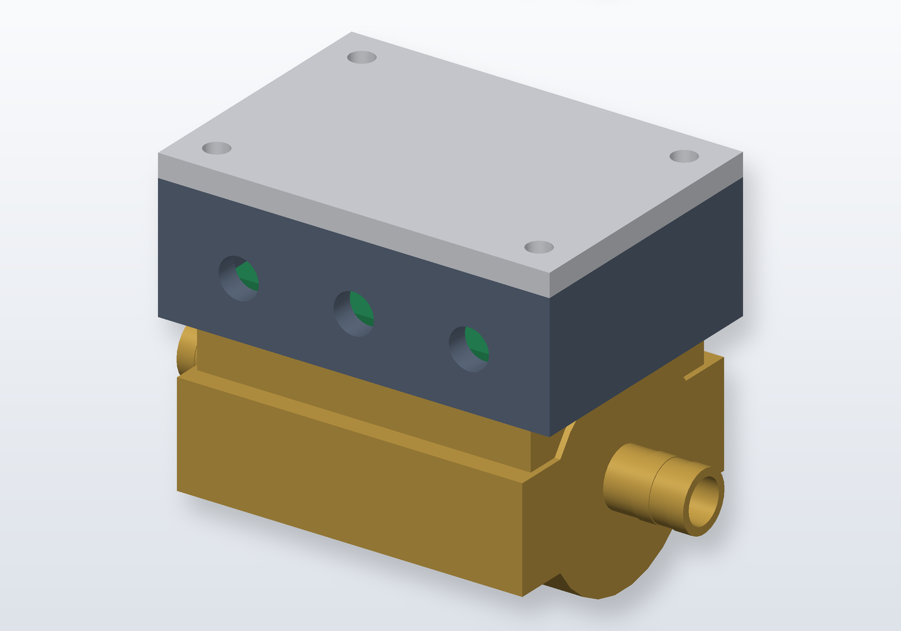
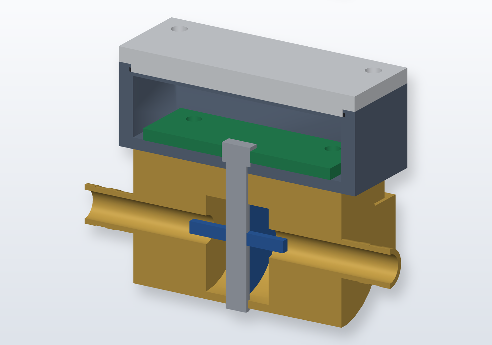
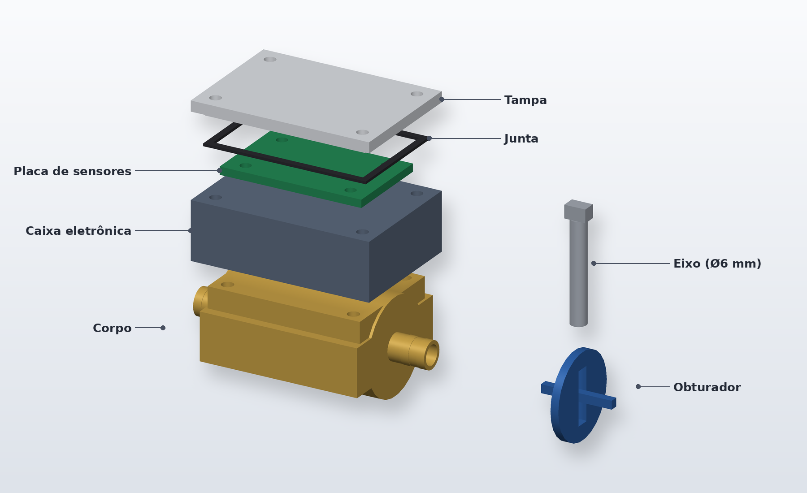
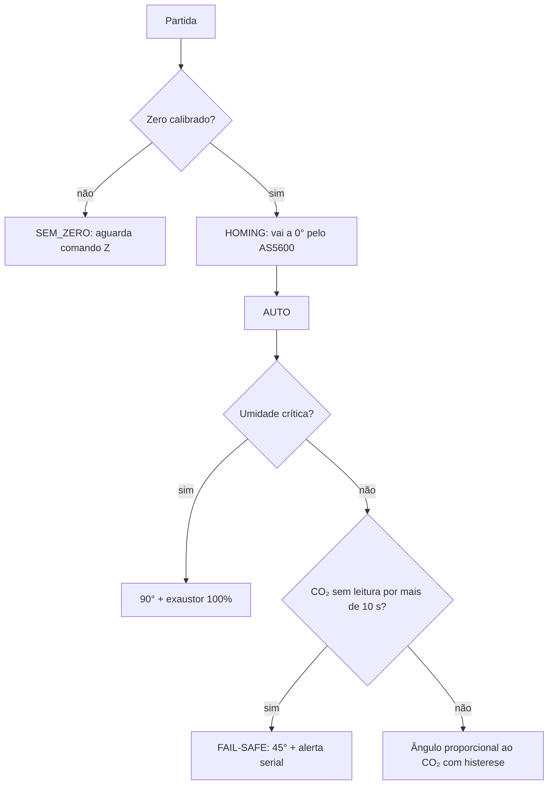

# Damper de Micro-Ventilação com Controle Proporcional de CO₂ (10 mm)

Válvula **borboleta rotativa** de 90° que regula a renovação de ar de **terrários, incubadoras e pequenas estufas biológicas**. Um sensor NDIR mede o CO₂ e o firmware ajusta o ângulo do disco entre 0° e 90° em malha fechada (encoder magnético AS5600), acionando um micro-exaustor quando a ventilação passiva não basta.

Derivado do projeto [controlador-de-fluido-10mm](https://github.com/jfgonjr/controlador-de-fluido-10mm). **A mecânica (CAD) não foi alterada**; apenas o firmware foi reescrito.

[](docs/montagem.png)

**88 × 50 × 62 mm** · disco Ø32 mm · curso de 90° · 12 V · Arduino Nano / Pro Mini / ESP32

> ⚠️ **Protótipo.** Veja o [aviso de segurança](#aviso-de-segurança) e a seção [Status de testes](#status-de-testes).

---

## Sumário

- [Como funciona](#como-funciona)
- [Mecânica (CAD)](#mecânica-cad)
- [Hardware](#hardware)
- [Pinagem](#pinagem)
- [Firmware](#firmware)
- [Lógica de controle](#lógica-de-controle)
- [Segurança biológica](#segurança-biológica)
- [Comandos seriais](#comandos-seriais)
- [Telemetria](#telemetria)
- [Compilar e gravar](#compilar-e-gravar)
- [Primeira calibração](#primeira-calibração)
- [Parâmetros](#parâmetros)
- [Status de testes](#status-de-testes)
- [Estrutura do repositório](#estrutura-do-repositório)
- [Aviso de segurança](#aviso-de-segurança)

---

## Como funciona

| Ângulo  | Disco                  | Estado                                     |
| ------- | ---------------------- | ------------------------------------------ |
| **0°**  | perpendicular ao fluxo | fechada: retém umidade, calor e gases      |
| **90°** | alinhado ao fluxo      | aberta: exaustão máxima                    |

Não há fins de curso. Um ímã diametral na ponta do eixo é lido pelo **AS5600** (I²C), que informa o ângulo absoluto. O travamento do motor também é detectado pelo encoder: motor acionado com ângulo parado significa obstrução.

## Mecânica (CAD)

A mecânica é **idêntica à do controlador de água original**: nenhuma peça foi alterada. Cada peça está em **STEP** (editável) e **STL** (impressão 3D); a montagem completa está em [`cad/step/controlador_agua_10mm_assembly.step`](cad/step/controlador_agua_10mm_assembly.step).

| Peça                  | Dimensões (mm) | Descrição                                                                                                                        |
| --------------------- | -------------- | -------------------------------------------------------------------------------------------------------------------------------- |
| **Corpo**             | 88 × 50 × 36   | Canal Ø10 no eixo X, rebaixos Ø10,3 nas pontas, câmara Ø32 para o obturador, bucha do eixo Ø6,36 e fixação 4× M4 em (±24, ±17)   |
| **Obturador**         | Ø32 × 3        | Disco com furo central Ø6 para o eixo                                                                                            |
| **Eixo**              | Ø6 × 43        | Vertical (Z). A ponta superior fica dentro da caixa eletrônica e leva o ímã                                                      |
| **Caixa eletrônica**  | 68 × 48 × 22   | Três passagens Ø7 na parede +Y, em x = −20 / 0 / +20                                                                             |
| **Placa de sensores** | 54 × 34 × 3    | PCB com furos M4 em (±20, ±12), centrada sobre a ponta do eixo                                                                   |
| **Junta**             | 62 × 42 × 1    | Vedação da caixa                                                                                                                 |
| **Tampa**             | 68 × 48 × 6    | Fecha a caixa, 4 furos de fixação                                                                                                |

> Unidades em milímetros. Origem no centro do corpo; Z aponta para cima. O nome "agua" nos arquivos CAD foi mantido para preservar a compatibilidade com o projeto original.

[](docs/corte.png)
[](docs/explodida.png)

---

## Hardware

| Item                | Especificação                                                                 |
| ------------------- | ----------------------------------------------------------------------------- |
| Microcontrolador    | Arduino Nano / Pro Mini (ATmega328P) ou ESP32 / ESP32-C3                      |
| Encoder             | AS5600 (I²C, 0x36) + ímã diametral no eixo                                    |
| Atuador             | Micromotor DC com redutor (N20 ou similar) + ponte H **DRV8833** ou **L9110** |
| Sensor de CO₂       | **MH-Z19B** (UART, 9600 baud) ou **SCD30** (I²C, 0x61)                        |
| Temp. / umidade     | **DHT22**, **BME280** (I²C) ou o próprio SCD30                                |
| Micro-exaustor      | Ventoinha 12 V via **MOSFET de nível lógico** + diodo de flyback              |
| Sinalização         | 2 LEDs (verde / vermelho) e buzzer passivo                                    |

### Fiação pelas passagens Ø7 mm da caixa

Ajuste conforme a sua montagem; o CAD original prevê três passagens em x = −20 / 0 / +20 mm:

| Posição | Sugestão de uso                                  |
| ------- | ------------------------------------------------ |
| x = −20 | Alimentação 12 V                                 |
| x = 0   | Sensores ambientais (CO₂ e temperatura/umidade)  |
| x = +20 | Cabo do micro-exaustor                           |

## Pinagem

| Função                         | Arduino Nano / Pro Mini | ESP32 / ESP32-C3 |
| ------------------------------ | ----------------------- | ---------------- |
| I²C SDA / SCL (AS5600)         | A4 / A5                 | 8 / 9            |
| Ponte H IN1 (PWM)              | 5                       | 3                |
| Ponte H IN2 (PWM)              | 6                       | 4                |
| Exaustor (PWM → MOSFET)        | 10                      | 5                |
| MH-Z19B RX do MCU ← TX do sensor | 2 (SoftwareSerial)    | 6 (Serial1)      |
| MH-Z19B TX do MCU → RX do sensor | 4 (SoftwareSerial)    | 7 (Serial1)      |
| DHT22 (dados)                  | 7                       | 10               |
| Buzzer                         | 9                       | 2                |
| LED verde                      | 3                       | 20               |
| LED vermelho                   | 11                      | 21               |

> **Por que o exaustor está no pino 10 e o LED verde no 3 (AVR)?** `tone()` usa o Timer2 e desativa o PWM dos pinos 3 e 11. O exaustor precisa de PWM, então ficou no Timer1 (pino 10).
>
> **ESP32:** exige o core **Arduino-ESP32 ≥ 3.0**. Confira os pinos contra a sua placa; no ESP32-C3 os GPIO 20/21 coincidem com a UART0 padrão.

## Firmware

Arquivo: [`firmware/damper_co2_10mm/damper_co2_10mm.ino`](firmware/damper_co2_10mm/damper_co2_10mm.ino)

Sketch único, organizado em módulos comentados: configuração persistente, encoder, PWM/motor, sensor de CO₂, sensor de temperatura/umidade, posicionador, controle, supervisão, comandos/telemetria e sinalização.

Seleção de hardware no início do código:

```cpp
#define CO2_SENSOR CO2_MHZ19B   // ou CO2_SCD30
#define TH_SENSOR  TH_DHT22     // ou TH_BME280 / TH_SCD30
```

## Lógica de controle

| Condição                              | Válvula                            | Exaustor            |
| ------------------------------------- | ---------------------------------- | ------------------- |
| CO₂ < limite inferior (600 ppm)       | 0° (fechada)                       | desligado           |
| inferior ≤ CO₂ < superior (600–1200)  | proporcional, em degraus de 15°    | desligado (*)       |
| CO₂ ≥ superior (1200 ppm)             | 90°                                | 100 %               |
| Umidade ≥ crítica (95 % UR)           | 90°                                | 100 %               |

(*) Há a opção `FAN_FAIXA_MEDIA` para ventoinha proporcional também na faixa média.

**Degraus:** o ângulo é `ceil(fração × 90° / passo) × passo`, limitado a `[passo, 90° − passo]`. Com passo de 15°: 15°, 30°, 45°, 60° e 75°. O 90° só é atingido ao cruzar o limite superior.

**Histerese:** subir é imediato. Para **reduzir**, o CO₂ precisa cair `Hist_ppm` (padrão 50 ppm) abaixo da fronteira do degrau. Isso evita oscilação do motor quando a leitura fica na divisa. A umidade crítica tem histerese própria (liga em ≥ 95 %, desliga abaixo de 92 %).

**Exaustor:** só liga com a válvula acima de 75°, para não soprar contra o disco fechado.



## Segurança biológica

- **Homing na partida:** a válvula sempre vai a 0° antes de qualquer outra ação.
- **Fail-safe de sensor:** sem leitura válida de CO₂ por mais de 10 s, a válvula abre a 45° e emite alerta JSON a cada 5 s. A saída exige 3 leituras válidas seguidas.
- **Warm-up:** durante o aquecimento do sensor (60 s por padrão) a válvula permanece fechada. O datasheet do MH-Z19B pede cerca de 3 min; ajuste `T_WARMUP_CO2`.
- **ABC desativado:** o auto-ajuste do MH-Z19B assume 400 ppm como mínimo diário e causaria deriva em ambiente fechado. Pode ser religado em `MHZ_DESATIVAR_ABC`.
- **Manual com validade:** o modo `M` expira em 10 min e volta ao automático.
- **Falhas mecânicas:** em travamento, recua e tenta 2 vezes. Persistindo, para o motor e repete a tentativa a cada 30 s.
- **Encoder ou ímã ausente:** motor parado e alerta, pois sem o AS5600 não há malha fechada.
- **Leituras implausíveis** (CO₂ < 100 ou > 10000 ppm, umidade fora de 0–100 %) são descartadas.
- **Persistência:** setpoints, histerese, zero e sentido ficam em EEPROM (AVR) ou NVS (ESP32).

## Comandos seriais

115200 baud, terminar com Enter.

| Comando | Ação |
| ------- | ---- |
| `S` | Mostra a configuração atual |
| `S<inf>,<sup>[,<hist>[,<umid>[,<passo>]]]` | Grava setpoints. Ex.: `S600,1200,50,95,15` |
| `Z` | Grava a posição **atual** como 0°. O disco deve estar fechado |
| `I` | Inverte o sentido de leitura do encoder |
| `M<graus>` | Modo manual de posição (0–90). Ex.: `M45` |
| `F<0-100>` | Exaustor em % (somente em manual). Ex.: `F60` |
| `A` | Volta ao controle automático |
| `H` | Refaz o homing |
| `?` | Status e configuração |

Regras de validação do `S`: 200 ≤ inf < sup ≤ 10000; histerese entre 5 e (sup − inf)/2; umidade crítica entre 50 e 100; passo entre 5 e 45. Valores inválidos são rejeitados e a configuração anterior é mantida.

## Telemetria

Uma linha JSON por segundo:

```json
{"CO2_ppm":850,"Temp":25.4,"Umid":75,"Angulo":30,"Exaustor":1,"ExaustorPct":100,"Alvo":30,"Modo":"AUTO"}
```

Campos sem leitura saem como `null`. Valores de `Modo`: `AUTO`, `FAILSAFE`, `MANUAL`, `HOMING`, `SEM_ZERO`, `FALHA_MEC`, `ENCODER_FALHA`.

Alertas e avisos também saem em JSON:

```json
{"ALERTA":"CO2_SEM_RESPOSTA","acao":"VALVULA_45_GRAUS"}
{"INFO":"HOMING_OK","Angulo":0}
```

## Compilar e gravar

1. Abra o `.ino` na **Arduino IDE** (a pasta tem o mesmo nome do sketch, como a IDE exige).
2. Instale somente as bibliotecas da opção escolhida:

   | Opção       | Biblioteca                                              |
   | ----------- | ------------------------------------------------------- |
   | `TH_DHT22`  | *DHT sensor library* (Adafruit) + *Adafruit Unified Sensor* |
   | `TH_BME280` | *Adafruit BME280 Library* + *Adafruit Unified Sensor*   |
   | `CO2_SCD30` | *SparkFun SCD30 Arduino Library*                        |
   | `CO2_MHZ19B`| nenhuma (protocolo implementado no código)              |

3. Selecione a placa (Arduino Nano, ESP32-C3 etc.) e a porta, compile e grave.

## Primeira calibração

1. Grave o firmware. Se não houver zero salvo, ele avisa `ZERO_NAO_CALIBRADO` e **não move o motor**.
2. Feche o disco manualmente (perpendicular ao fluxo) e envie `Z`.
3. Teste `M90` e confirme que o disco abre. Se o ângulo cresce no sentido errado, envie `I` e refaça o `Z`.
4. Envie `A` para o modo automático.

Quem vem do firmware de água em AVR tem o zero e o sentido migrados automaticamente. Confirme com a válvula fechada ou refaça com `Z`.

## Parâmetros

| Constante                | Padrão  | Descrição                                           |
| ------------------------ | ------- | --------------------------------------------------- |
| `PADRAO_CO2_INF`         | 600 ppm | Abaixo disso: fechada                               |
| `PADRAO_CO2_SUP`         | 1200 ppm| Acima disso: 90° + exaustor                         |
| `PADRAO_CO2_HIST`        | 50 ppm  | Histerese para reduzir a abertura                   |
| `PADRAO_UMID_CRIT`       | 95 %    | Umidade que força abertura total                    |
| `PADRAO_PASSO`           | 15°     | Degrau da faixa proporcional                        |
| `T_FAILSAFE_CO2`         | 10 s    | Tempo sem leitura até o fail-safe                   |
| `ANG_FAILSAFE`           | 45°     | Posição durante o fail-safe                         |
| `FAILSAFE_FAN_PWM`       | 0       | Exaustor durante o fail-safe (0–255)                |
| `T_WARMUP_CO2`           | 60 s    | Aquecimento do sensor com válvula fechada           |
| `T_MANUAL_MAX`           | 10 min  | Validade do modo manual                             |
| `TOL_PARADA`             | 2,5°    | Janela de "chegou"                                  |
| `PWM_MIN`                | 90      | Mínimo para vencer o atrito da bucha                |
| `BUZZER_ATIVO`           | `true`  | Bipe de alerta                                      |

Os quatro primeiros são os valores iniciais; depois do comando `S` valem os salvos na memória.

## Status de testes

- Sintaxe verificada para o ramo **AVR** com bibliotecas simuladas.
- Lógica de degraus e histerese simulada em PC (subida e descida).
- **Não testado em hardware**, nem no ramo ESP32, nem com as bibliotecas reais de DHT, SCD30 e BME280.

Teste em bancada antes de instalar: sensor de CO₂ desconectado (fail-safe), `M0` e `M90` (curso e sentido) e um sopro no sensor para ver a faixa proporcional.

## Estrutura do repositório

```
controlador-de-fluido-10mm/
├── README.md
├── docs/                                  imagens (montagem, corte, explodida)
├── cad/
│   ├── step/                              modelos editáveis (peças + montagem)
│   └── stl/                               malhas para impressão 3D
└── firmware/
    ├── damper_co2_10mm/                   <- NOVO: damper + controle proporcional de CO2
    │   └── damper_co2_10mm.ino
    └── firmware_controlador_agua_10mm/    firmware original (corte por vazamento), preservado
        └── firmware_controlador_agua_10mm.ino
```

O firmware original de água continua no repositório. Para voltar à função de válvula de vazamento, grave o sketch dessa pasta; a mecânica e a placa são as mesmas.

---

## Aviso de segurança

Este projeto é um protótipo e **não substitui** controle ambiental, alarme ou monitoramento redundante para animais ou culturas de valor. Valide a lógica em bancada, observe o sistema por alguns dias antes de confiar nele e mantenha uma forma independente de verificar CO₂, temperatura e umidade.

## Créditos

Mecânica e base do firmware: [jfgonjr/controlador-de-fluido-10mm](https://github.com/jfgonjr/controlador-de-fluido-10mm).
